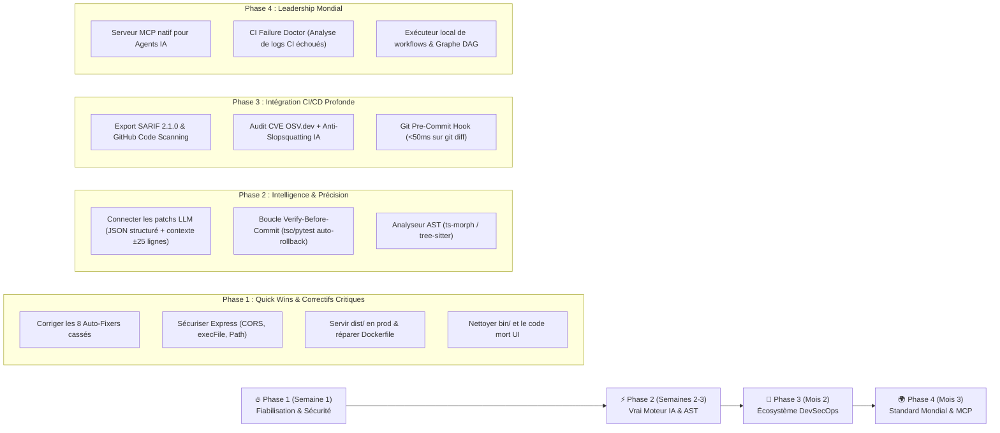

# 🛡️ Rapport d'Audit Technique Approfondi — Aegis CI/CD Toolbox
**Auditeur :** Senior Full-Stack & DevSecOps Principal Architect  
**Date de l'audit :** 23 Octobre 2026  
**Cible :** `ci-cd-toolbox` v1.0.0 (`F:/APP/ci-cd-toolbox`)  
**Périmètre :** Architecture Full-Stack (React 19 / Express / CLI), Moteur d'Analyse Statique (4 analyseurs), Moteur d'Auto-Correction IA Hybride, Sécurité DevSecOps, Docker & Pipelines CI/CD.

---

## 1. Synthèse Exécutive & Verdict Global

| Dimension Auditée | Note Actuelle | Verdict Technique |
| :--- | :---: | :--- |
| **Capacité réelle à détecter des bugs** | **6.5 / 10** | Bonnes heuristiques DevOps/Config, mais analyse purement Regex ligne-par-ligne (aucun véritable AST). |
| **Capacité réelle à résoudre des bugs (Auto-Fix)** | **4.0 / 10** | **Critique** : Répare les fichiers de config, mais **casse le code applicatif** sur plusieurs règles et **n'utilise pas réellement l'IA pour patcher**. |
| **Cohérence Full-Stack & Architecture** | **5.5 / 10** | Code mort (widgets orphelins), file offline factice, serveur de prod qui ne sert pas le frontend compilé. |
| **Sécurité intrinsèque de l'outil (DevSecOps)** | **5.0 / 10** | Serveur local vulnérable au CSRF cross-origin (`cors()` ouvert), injection shell dans `/api/fs/open-editor`, Dockerfile cassé. |
| **Ergonomie UI/UX & Vision Produit** | **8.5 / 10** | Excellente vision produit, interface sombre sobre et réactive, chiffrement E2EE WebCrypto bien implémenté. |
| **SCORE GLOBAL D'AUDIT** | **5.9 / 10** | **Un prototype très prometteur dans sa vision, mais qui relève aujourd'hui du "Smoke & Mirrors" sur sa partie IA et AST.** |

> [!IMPORTANT]
> **Réponse directe à la question : « L'outil est-il réellement capable de résoudre des bugs ? »**  
> **Non pour les bugs de logique ou de code complexe ; Oui uniquement pour l'initialisation et le durcissement de fichiers de configuration.**  
> Actuellement, l'outil résout efficacement les oublis de configuration DevOps (création de `.gitignore`, `.dockerignore`, workflows GitHub Actions, ajout de flags dans `package.json` ou `tsconfig.json`). En revanche, dès qu'il touche au **code source applicatif** (Python, TypeScript, SQL, Rust), son moteur de remplacement par expressions régulières (Regex) est **aveugle au contexte syntaxique** et **introduit lui-même des bugs bloquants au runtime** dans au moins 6 cas documentés ci-dessous. De plus, le moteur IA (Gemini, OpenAI, Ollama) est actuellement **débranché du système de patch** : le code généré par l'IA est jeté et remplacé par la chaîne statique pré-calculée.

---

## 2. Audit Approfondi : Est-il réellement capable de résoudre des bugs ?

### 2.1. La grande illusion du Moteur IA Hybride ("Smoke & Mirrors")

L'analyse du code de [`src/services/aiEngine.ts`](file:///f:/APP/ci-cd-toolbox/src/services/aiEngine.ts) et de [`src/App.tsx`](file:///f:/APP/ci-cd-toolbox/src/App.tsx) révèle que **l'IA ne corrige jamais aucun fichier** :

1. **Le code retourné par le LLM est ignoré dans `aiEngine.ts` :**
   - Aux lignes **203** (Ollama), **248** (Google Gemini) et **290** (OpenAI / OpenRouter / Groq) de [`src/services/aiEngine.ts`](file:///f:/APP/ci-cd-toolbox/src/services/aiEngine.ts#L194-L298), lorsque l'API IA répond, la fonction retourne systématiquement :
     ```ts
     explanation: text.slice(0, 420) || finding.autoFix.summary,
     patchedCode: finding.autoFix.afterSnippet, // <-- N'utilise JAMAIS la réponse du LLM !
     ```
   - La réponse du modèle IA est simplement tronquée à 420 caractères et placée dans le champ texte `explanation`.
2. **Le bouton "Apply Patch" n'envoie jamais le résultat de l'IA au serveur :**
   - Dans [`src/App.tsx` (lignes 491-513)](file:///f:/APP/ci-cd-toolbox/src/App.tsx#L491-L513), la fonction `handleApplyFix(finding)` envoie `fix: finding.autoFix` à `POST /api/fix` sans jamais consulter `aiResult`.
3. **La CLI ignore totalement `aiEngine.ts` :**
   - [`server/cliRunner.ts`](file:///f:/APP/ci-cd-toolbox/server/cliRunner.ts#L48-L60) exécute uniquement `applyAutoFixOnDisk()` avec les snippets statiques des analyseurs. Le fichier `.cicd-toolbox.json` généré par `ci-cd-toolbox init` ([`bin/ci-cd-toolbox.js` L83-108](file:///f:/APP/ci-cd-toolbox/bin/ci-cd-toolbox.js#L83-L108)) n'est d'ailleurs **lu par aucun fichier du projet**.

---

### 2.2. Les 8 Auto-Fixers qui CASSENT le code en production

Parce que l'outil prétend utiliser un *"Moteur Déterministe AST"* alors qu'il n'utilise en réalité que des `String.prototype.replace()` et des Regex ligne par ligne ([`server/scanner.ts` L330-356](file:///f:/APP/ci-cd-toolbox/server/scanner.ts#L330-L356)), plusieurs auto-corrections corrompent le code cible :

#### 🔴 Bug Critique #1 : `AI-QUAL-004` (Arguments mutables Python) provoque un `AttributeError` immédiat
- **Fichier :** [`server/analyzers/aiCodeQualityAnalyzer.ts` (L270-298)](file:///f:/APP/ci-cd-toolbox/server/analyzers/aiCodeQualityAnalyzer.ts#L270-L298)
- **Mécanisme actuel :** Remplace `def append_item(item, bucket=[]):` par `def append_item(item, bucket=None):` avec **95% de confiance** (`reliable: true`), **sans injecter** `if bucket is None: bucket = []` dans le corps de la fonction.
- **Conséquence :** Dès la première ligne de la fonction (`bucket.append(item)`, exactement comme dans le test [`tests/toolbox.test.ts` L99-100](file:///f:/APP/ci-cd-toolbox/tests/toolbox.test.ts#L99-L100)), Python lève `AttributeError: 'NoneType' object has no attribute 'append'`. **L'auto-fix transforme un code qui tourne en un crash fatal.**

#### 🔴 Bug Critique #2 : `SEC-003` (Secrets en dur) injecte du JavaScript dans du Go/Rust et oublie `import os` en Python
- **Fichier :** [`server/analyzers/securityAnalyzer.ts` (L173-207)](file:///f:/APP/ci-cd-toolbox/server/analyzers/securityAnalyzer.ts#L173-L207)
- **Mécanisme actuel :**
  ```ts
  const replacementExpr =
    ext === '.py' ? `os.environ.get("${sig.envName}", "")`
    : ext === '.php' ? `$_ENV['${sig.envName}'] ?? ''`
    : `process.env.${sig.envName} || ""`;
  ```
- **Conséquences :**
  1. Si un secret est trouvé dans un fichier `.go` ou `.rs` (pourtant inclus dans `codeExtensions` ligne 134), l'outil remplace le secret par `process.env.OPENAI_API_KEY || ""` (du JavaScript invalide en Go et en Rust, cassant la compilation).
  2. En Python (`.py`), il injecte `os.environ.get(...)` sans vérifier si `import os` est présent dans le fichier (`NameError: name 'os' is not defined`).
  3. Si un fichier `.env` est scanné (inclus ligne 134), il remplace `OPENAI_API_KEY="sk-..."` par `OPENAI_API_KEY=process.env.OPENAI_API_KEY || ""` dans le fichier `.env` !

#### 🔴 Bug Critique #3 : `SEC-006` (`shell=True` en Python) casse l'exécution des sous-processus
- **Fichier :** [`server/analyzers/securityAnalyzer.ts` (L282-308)](file:///f:/APP/ci-cd-toolbox/server/analyzers/securityAnalyzer.ts#L282-L308)
- **Mécanisme actuel :** Remplace `shell=True` par `shell=False` avec `confidence: 93, reliable: true`.
- **Conséquence :** En Python, `subprocess.run("git status -s", shell=True)` fonctionne, mais `subprocess.run("git status -s", shell=False)` cherche un binaire nommé littéralement `"git status -s"` avec des espaces et plante avec `FileNotFoundError` tant que la chaîne n'est pas découpée en liste `["git", "status", "-s"]` via `shlex.split()`.

#### 🔴 Bug Critique #4 : `SEC-007` (Injection SQL) génère des requêtes SQL syntaxiquement invalides
- **Fichier :** [`server/analyzers/securityAnalyzer.ts` (L312-343)](file:///f:/APP/ci-cd-toolbox/server/analyzers/securityAnalyzer.ts#L312-L343)
- **Mécanisme actuel :** `trimmed.replace(/\$\{[^}]+\}/g, '?')`.
- **Conséquence :**
  1. Ne fonctionne que sur la syntaxe JS `${var}` : sur une f-string Python `f"SELECT * FROM users WHERE name = {item}"` ou une concaténation `"SELECT ... " + item`, le regex `/\$\{[^}]+\}/g` ne matche rien (`afterSnippet` est identique à `beforeSnippet`).
  2. En JS/TS, remplacer `` db.query(`SELECT * FROM users WHERE id = ${id}`) `` par `` db.query(`SELECT * FROM users WHERE id = ?`) `` sans passer `[id]` en second argument fait échouer la requête SQL en production.

#### 🔴 Bug Critique #5 : `CICD-006` (Injection Shell GitHub Actions) détruit l'étape du workflow
- **Fichier :** [`server/analyzers/pipelineAnalyzer.ts` (L194-225)](file:///f:/APP/ci-cd-toolbox/server/analyzers/pipelineAnalyzer.ts#L194-L225)
- **Mécanisme actuel :** Remplace toute la ligne `run: ...` par `# Sécurisé via variable env $PR_TITLE\n echo "$SAFE_EVENT_INPUT"` avec `confidence: 91, reliable: true`.
- **Conséquence :** Supprime purement et simplement la commande de build/notification de l'utilisateur et affiche une variable `$SAFE_EVENT_INPUT` qui n'est même pas définie dans le bloc `env:` du step.

#### 🔴 Bug Critique #6 : `DOCKER-002` & `DOCKER-004` corrompent le `Dockerfile`
- **Fichier :** [`server/analyzers/dependenciesAndInfraAnalyzer.ts` (L53-80 et L115-143)](file:///f:/APP/ci-cd-toolbox/server/analyzers/dependenciesAndInfraAnalyzer.ts#L53-L143)
- **Mécanisme actuel :**
  1. `DOCKER-002` utilise `actionType: 'append-file'` avec `afterSnippet: 'USER node\n' + dockerLines.slice(-2).join('\n')`. Or, `append-file` dans [`server/scanner.ts` (L315-320)](file:///f:/APP/ci-cd-toolbox/server/scanner.ts#L315-L320) concatène `afterSnippet` à la fin du fichier ! Les 2 dernières lignes du Dockerfile sont donc **dupliquées**, et `USER node` est ajouté même sur une image `python:3.12-slim` ou `golang:1.23` où l'utilisateur `node` n'existe pas (faisant échouer `docker build` / `docker run`).
  2. `DOCKER-004` injecte en dur `HEALTHCHECK ... http://localhost:4177/api/health` (le port interne d'Aegis Toolbox !) dans le Dockerfile de n'importe quel projet externe (qu'il écoute sur le port 3000, 8000, 8080 ou que ce soit un worker CLI sans serveur HTTP).

#### 🟠 Bug Majeur #7 : `AI-QUAL-002` (`: any` $\rightarrow$ `: unknown`) casse la compilation TypeScript
- **Fichier :** [`server/analyzers/aiCodeQualityAnalyzer.ts` (L203-231)](file:///f:/APP/ci-cd-toolbox/server/analyzers/aiCodeQualityAnalyzer.ts#L203-L231)
- **Mécanisme actuel :** Remplace `: any` par `: unknown` avec `confidence: 92, reliable: true` (donc exécuté automatiquement lors d'un `Fix All` ou `ci-cd-toolbox fix`).
- **Conséquence :** En TypeScript, contrairement à `any`, on ne peut accéder à aucune propriété d'une variable `unknown` sans *type narrowing* préalable (`TS2571: Object is of type 'unknown'`). Remplacer aveuglément `: any` par `: unknown` fait immédiatement échouer `tsc --noEmit` sur tout le projet.

#### 🟠 Bug Majeur #8 : `PY-002` (`requirements.txt` non épinglé) invente une version `>=1.0.0` fictive
- **Fichier :** [`server/analyzers/dependenciesAndInfraAnalyzer.ts` (L387-398)](file:///f:/APP/ci-cd-toolbox/server/analyzers/dependenciesAndInfraAnalyzer.ts#L387-L398)
- **Mécanisme actuel :** Remplace `fastapi` ou `uvicorn` par `fastapi>=1.0.0` et `uvicorn>=1.0.0` (`confidence: 90, reliable: true`).
- **Conséquence :** De nombreux paquets Python majeurs (ex: `fastapi` 0.115.x, `uvicorn` 0.34.x, `python-dotenv` 1.0.x, `httpx` 0.28.x) ont une version majeure `< 1.0.0` sur PyPI ! Injecter `>=1.0.0` fait immédiatement planter `pip install -r requirements.txt` avec `ERROR: No matching distribution found for fastapi>=1.0.0` !

---

## 3. Audit de Cohérence, d'Architecture et de Fonctionnement

### 3.1. Le "Dogfooding" Biaisé : Aegis s'auto-exclut de ses propres règles
Dans [`server/analyzers/securityAnalyzer.ts` (L142-149)](file:///f:/APP/ci-cd-toolbox/server/analyzers/securityAnalyzer.ts#L142-L149) et [`server/analyzers/aiCodeQualityAnalyzer.ts` (L85-92)](file:///f:/APP/ci-cd-toolbox/server/analyzers/aiCodeQualityAnalyzer.ts#L85-L92), on trouve ce filtre :
```ts
if (
  relFile.startsWith('server/analyzers/') ||
  relFile === 'server/scanner.ts' ||
  relFile === 'tests/toolbox.test.ts' ||
  relFile === 'src/services/aiEngine.ts'
) {
  continue;
}
```
Si l'on comprend l'exclusion des signatures Regex d'`analyzers/`, l'exclusion de `scanner.ts` et `aiEngine.ts` dans l'analyseur de qualité IA cache une réalité : **le code d'Aegis lui-même contient plus de 20 blocs `catch {}` vides** (ex: `server/index.ts` L119, L177, L248, L334, L498 ; `src/App.tsx` L114, L122, L331, L353, L415, L510, L567 ; `src/services/aiEngine.ts` L118, L138, L213, L257, L299). Ils ne sont pas détectés uniquement parce que le regex de `AI-QUAL-001` (`/catch\s*(\([^)]*\))?\s*\{\s*\}/`) ne teste qu'une **seule ligne** (`line`) et échoue dès que le bloc `catch {\n // commentaire \n}` s'étale sur 3 lignes !

### 3.2. Artefacts Parasites dans le Dépôt (`bin/`)
L'inspection de l'arborescence montre que le dossier [`bin/`](file:///f:/APP/ci-cd-toolbox/bin) a été pollué par une exécution d'auto-fix ciblée par erreur sur `bin/` :
- `bin/.github/workflows/ci-cd-aegis.yml`
- `bin/Dockerfile`
- `bin/.gitignore`
- `bin/tests/smoke.test.ts`

Ces 4 fichiers n'ont rien à faire dans `bin/` et prouvent que l'outil écrit à la racine de n'importe quel sous-dossier sélectionné sans vérifier s'il s'agit de la racine d'un projet.

### 3.3. Incohérence entre le `README.md`, les Services et l'Interface Réelle (`src/App.tsx`)
1. **Code mort (Dead Code) :**
   - [`src/components/WidgetShell.tsx`](file:///f:/APP/ci-cd-toolbox/src/components/WidgetShell.tsx) et [`src/components/ExternalProjectSelectorBar.tsx`](file:///f:/APP/ci-cd-toolbox/src/components/ExternalProjectSelectorBar.tsx) ne sont importés nulle part.
   - `widgets` et `setWidgets` dans [`src/App.tsx` (L177)](file:///f:/APP/ci-cd-toolbox/src/App.tsx#L177) sont chargés depuis `localStorage` et synchronisés dans le coffre E2EE, mais ne sont **jamais utilisés dans le JSX** (l'application ayant migré vers 7 onglets fixes).
2. **Système de Thèmes Cassé :**
   - [`src/index.css`](file:///f:/APP/ci-cd-toolbox/src/index.css#L5-L44) définit 4 thèmes (`obsidian-cyber`, `midnight-slate`, `emerald-matrix`, `high-contrast`) via des variables CSS `--studio-bg`, `--studio-panel`, etc.
   - Mais [`src/App.tsx`](file:///f:/APP/ci-cd-toolbox/src/App.tsx#L734) utilise des classes Tailwind codées en dur (`bg-[#090a0c]`, `bg-[#101115]`, `border-[#22242c]`). Changer le thème dans le menu *Settings* modifie `data-theme` sur `<html>`, mais **aucune couleur de l'interface ne change** ! De plus, le thème `emerald-matrix` a été oublié dans le `<select>` de `App.tsx` (L869-872).
3. **File d'attente Hors-Ligne (Offline Queue) Factice :**
   - Dans [`src/App.tsx` (L260-272)](file:///f:/APP/ci-cd-toolbox/src/App.tsx#L260-L272), lorsque la connexion revient (`window.addEventListener('online')`), le code fait :
     ```ts
     const q = loadOfflineQueue();
     if (q.length > 0) {
       clearOfflineQueue();
       setOfflineQueue([]);
       pushSmartNotification('Network Restored', `${q.length} queued offline operation(s) synchronized.`);
     }
     ```
   - **Aucune requête réseau n'est envoyée pour dépiler et appliquer réellement les actions mises en file d'attente !** C'est une simulation purement cosmétique.

### 3.4. Déploiement Production & Docker Non Fonctionnels
1. **`server/index.ts` ne sert pas le frontend (`dist/`) :**
   - En développement (`npm run dev`), Vite tourne sur le port `5173` et proxifie `/api` vers `4177`.
   - En production (`npm start` ou via `Dockerfile`), seul `node bin/ci-cd-toolbox.js start` est lancé sur le port `4177`. Comme `server/index.ts` ne contient aucun `app.use(express.static(path.join(AEGIS_ROOT_DIR, 'dist')))`, ouvrir `http://localhost:4177` renvoie `Cannot GET /` !
2. **`Dockerfile` plante au démarrage :**
   - [`Dockerfile` (L13 et L21)](file:///f:/APP/ci-cd-toolbox/Dockerfile#L13-L21) exécute `RUN npm ci --omit=dev`, ce qui supprime `tsx` (situé dans `devDependencies`). Puis `CMD ["node", "bin/ci-cd-toolbox.js", "start"]` tente d'exécuter `npx tsx server/index.ts`. En environnement conteneurisé ou hors-ligne, cela échoue ou télécharge `tsx` à la volée à chaque démarrage de conteneur.

---

## 4. Audit de Sécurité (DevSecOps) de l'Outil Lui-Même

Un outil DevSecOps qui audite la sécurité des autres projets se doit d'être irréprochable. Or, **4 vulnérabilités sérieuses** affectent le serveur local [`server/index.ts`](file:///f:/APP/ci-cd-toolbox/server/index.ts) :

1. **Critique — Vulnérabilité CSRF / Drive-By Localhost Exploitation (`server/index.ts` L23) :**
   - Le serveur Express active `app.use(cors())` (autorisant `*` toutes les origines web) sans aucun token d'authentification local (`X-Aegis-Token`).
   - **Scénario d'attaque :** Pendant que le développeur a `Aegis Studio` ouvert sur son PC, il visite une page web malveillante sur Internet. Ce site exécute un simple `fetch('http://localhost:4177/api/fs/browse', ...)` ou `fetch('http://localhost:4177/api/fix', { body: JSON.stringify({ projectPath: 'C:/Users/...', fix: { actionType: 'create-file', filePath: '...', afterSnippet: 'malicious code' } }) })` ! Le site distant peut **lire l'arborescence du disque et écrire/écraser n'importe quel fichier sur la machine du développeur**.
2. **Élevé — Injection de Commande Shell dans `/api/fs/open-editor` et `/api/fs/reveal-explorer` (`server/index.ts` L412 & L427) :**
   - Utilise `exec(\`code -g "${filePath}:${line}"\`)` et `exec(\`explorer.exe /select,"${target}"\`)` au lieu de `execFile()`.
   - Dans `/api/fs/pick-native` (L72-74), `initialDir` est injecté dans un script PowerShell via `.replace(/"/g, '')`, mais sans échapper les sous-expressions PowerShell `$(...)` ou le backtick `` ` `` ! Un dossier nommé `$(calc.exe)` exécute du code arbitraire dans PowerShell.
3. **Moyen — contournement partiel du Path Traversal (`server/index.ts` L407 & `server/scanner.ts` L289) :**
   - La vérification `if (!targetFile.startsWith(resolvedProject))` sans `path.sep` final (`resolvedProject + path.sep`) peut être contournée avec un dossier frère partageant le même préfixe (ex: `F:\APP\mon-projet` vs `F:\APP\mon-projet-secret\cle.pem`). Utiliser `path.relative(resolvedProject, targetFile).startsWith('..')` est la norme sécurisée Node.js.
4. **Moyen — Politique de sécurité contournable dans `/api/runner/exec` (`server/index.ts` L366-388) :**
   - La whitelist vérifie uniquement `command.startsWith('npm run ')` puis passe `command` à `exec()` (qui invoque un shell complet). Une requête POST envoyant `{"command": "npm run test && calc.exe"}` passe la validation `.startsWith('npm run ')` et exécute n'importe quelle commande shell !

---

## 5. Plan d'Action & Axes d'Amélioration Prioritaires (Court Terme)

### Priorité P0 — Fiabiliser le Moteur de Patch & Connecter Vraiment l'IA
1. **Brancher réellement la sortie du LLM dans `aiEngine.ts` et `App.tsx` :**
   - Dans [`src/services/aiEngine.ts`](file:///f:/APP/ci-cd-toolbox/src/services/aiEngine.ts), demander au LLM une réponse structurée JSON (`response_format: { type: "json_object" }`) contenant `{ "beforeSnippet": "...", "afterSnippet": "...", "explanation": "..." }`.
   - Extraire le bloc de code réel dans `patchedCode`.
   - Dans [`src/App.tsx`](file:///f:/APP/ci-cd-toolbox/src/App.tsx), permettre à l'utilisateur d'appliquer soit le patch déterministe, soit le patch `aiResult.patchedCode` généré par l'IA, et afficher le **vrai diff** du code IA dans l'inspecteur.
2. **Déplacer l'orchestration IA côté Backend (`/api/ai/remediate`) et CLI :**
   - Les appels Gemini/OpenAI/Ollama doivent pouvoir être exécutés par le serveur Express et par `ci-cd-toolbox fix --ai` en CLI (évitant au passage d'exposer les clés API dans le `localStorage` du navigateur en clair).
   - Fournir au LLM **le contexte complet autour de la ligne fautive** (±25 lignes du fichier réel lu sur disque + les imports du fichier) et non pas une seule ligne isolée (`beforeSnippet`).
3. **Corriger immédiatement les 8 Auto-Fixers cassés :**
   - **`AI-QUAL-004` (Python mutable default) :** Désactiver le remplacement aveugle mono-ligne ou inspecter l'indentation de la ligne `def ...:` pour insérer sur la ligne suivante `\n    if arg is None:\n        arg = []`.
   - **`SEC-003` (Secrets) :** Adapter la syntaxe de remplacement par langage (`os.Getenv("...")` en Go, `std::env::var("...")` en Rust) et ne pas remplacer l'intérieur même d'un fichier `.env` par `process.env`.
   - **`DOCKER-002` & `DOCKER-004` :** Créer une action `insert-before-cmd` dans `scanner.ts` (au lieu de `append-file` qui duplique la fin du fichier), détecter l'image de base (`FROM python` $\rightarrow$ `USER appuser`, `FROM node` $\rightarrow$ `USER node`), et détecter le port `EXPOSE` du Dockerfile pour le `HEALTHCHECK`.
   - **`PY-002` (`requirements.txt`) :** Résoudre la version réellement installée dans l'environnement (`pip show` ou registre PyPI) au lieu d'inventer `>=1.0.0`.
   - **`AI-QUAL-002` (`: any`) & `SEC-006` (`shell=True`) & `SEC-007` (SQLi) :** Marquer `reliable: false` pour qu'ils ne soient jamais appliqués à l'aveugle par le bouton `Fix All`, et les déléguer au moteur IA contextuel.

### Priorité P1 — Sécuriser le Serveur Local & Réparer la Production
1. **Verrouiller Express (`server/index.ts`) :**
   - Restreindre CORS à `origin: ['http://localhost:5173', 'http://localhost:4177', 'http://127.0.0.1:5173']`.
   - Remplacer tous les `exec()` par `execFile()` avec tableau d'arguments stricts (zéro interprétation de métacaractères shell `;`, `&&`, `|`, `$(...)`).
   - Dans `/api/runner/exec`, valider que le nom du script `npm run <script>` existe exactement parmi `Object.keys(pkg.scripts)` avant d'exécuter `execFile('npm', ['run', scriptName])`.
   - Utiliser `const rel = path.relative(resolvedProject, targetFile); if (rel.startsWith('..') || path.isAbsolute(rel))` pour bloquer tout Path Traversal.
2. **Rendre le build Docker & `npm start` 100% fonctionnels :**
   - Ajouter `app.use(express.static(path.join(AEGIS_ROOT_DIR, 'dist')))` dans `server/index.ts`.
   - Compiler `server/` ou déplacer `tsx` dans `dependencies` pour que le `Dockerfile` (`npm ci --omit=dev`) fonctionne nativement.
3. **Nettoyer le dépôt :**
   - Supprimer les fichiers parasites `bin/.github`, `bin/Dockerfile`, `bin/.gitignore`, `bin/tests`.
   - Connecter les variables CSS `--studio-*` aux classes de `App.tsx` et implémenter le vrai dépilage de `offlineQueue` au retour en ligne.

---

## 6. Vision Stratégique : Comment rendre Aegis incontournable et l'un des meilleurs outils DevOps au monde ? 🌍🚀

Pour passer d'un bon utilitaire de diagnostic local à un **standard mondial incontournable** (à la croisée de **SonarQube, Snyk, Semgrep, Dagger et Cursor**), voici les **7 innovations majeures ("Game-Changers")** à implémenter :

### 🌟 Innovation 1 : Analyse AST Universelle via Tree-Sitter / ts-morph (Zéro Faux-Positif)
Aujourd'hui, les outils basés sur des Regex échouent dès que le code est formaté sur plusieurs lignes.
- **Solution :** Intégrer **`web-tree-sitter`** (WASM, ultra-rapide, 100% hors-ligne) ou **`ts-morph` / `@babel/parser`**.
- **Impact :**
  - Détection exacte des blocs `try / catch` multi-lignes, des promesses flottantes (`no-floating-promises` nécessitant le graphe d'appels), des variables inutilisées, des injections SQL par analyse de flux de données (*Taint Analysis* : suivre une variable de `req.body` jusqu'à `db.query()`).
  - Générer des **patchs AST chirurgicaux** qui préservent le formatage et ajoutent automatiquement les `import` manquants en tête de fichier.

### 🌟 Innovation 2 : Boucle Agentique "Verify-Before-Commit" (Self-Healing Sandbox)
Le plus grand défaut des outils d'auto-fix actuels est qu'ils appliquent un patch **sans vérifier si le projet compile encore ou si les tests passent**.
- **Solution :** Implémenter un **Mode Validation Transactionnelle (Sandbox Loop)** dans `applyAutoFixOnDisk` :
  1. Aegis applique le patch (déterministe ou généré par IA).
  2. Aegis lance automatiquement en arrière-plan le compilateur/linter du projet (`tsc --noEmit`, `py_compile`, `cargo check`, `npm test`).
  3. **Si le build ou le test échoue :** Aegis **rollback automatiquement** en 10ms, ou renvoie l'erreur exacte du compilateur au LLM local (Ollama) pour qu'il corrige son propre patch (jusqu'à 3 tentatives) !
  4. **Résultat :** Une garantie mathématique **"100% Compiling Patch"** — aucun patch appliqué par Aegis ne peut jamais casser le build de l'utilisateur.

### 🌟 Innovation 3 : "CI Failure Doctor" — Diagnostic & Réparation Automatique des Logs CI/CD Cassés
En entreprise, la douleur n°1 des développeurs n'est pas d'écrire un YAML de zéro, mais de comprendre **pourquoi le pipeline GitHub Actions / GitLab CI vient d'échouer au bout de 12 minutes**.
- **Solution :** Ajouter un connecteur `gh run view --log-failed` (ou collage direct d'un log d'erreur CI/CD dans le Studio) :
  - Aegis parse la stacktrace du runner CI (erreur de build Docker, test Vitest/Pytest en échec, erreur de permission OIDC, conflit de dépendances NPM).
  - Il localise automatiquement le fichier et la ligne correspondante dans le dépôt local, génère le correctif, le teste localement et propose un commit `fix(ci): resolve pipeline failure` prêt à pousser.

### 🌟 Innovation 4 : Exécution Locale des Pipelines avant Push (Simulation GitHub Actions / Docker)
- **Solution :** Intégrer un mode **"Local Pipeline Dry-Run"** (inspiré de `act` / Dagger) qui lit les `steps:` de `.github/workflows/*.yml` et exécute localement chaque commande `run:` dans l'ordre avec un rapport visuel étape par étape (Durée, Cache hit, Code de sortie, Logs temps réel en streaming SSE/WebSocket).
- **Valeur ajoutée :** Fini les 15 commits `"fix ci"`, `"try again"`, `"fix yaml"` poussés sur GitHub pour tester un pipeline !

### 🌟 Innovation 5 : Audit Supply-Chain, CVE Réelles (OSV.dev) & Génération SBOM CycloneDX
Aujourd'hui, `dependenciesAndInfraAnalyzer.ts` vérifie seulement si une version est `"*"` ou `"latest"`.
- **Solution :**
  - Interroger en batch l'API gratuite et ouverte **OSV.dev (Google Open Source Vulnerabilities)** à partir de `package-lock.json`, `requirements.txt`, `Cargo.lock`, `go.sum` et `composer.lock` (avec cache local SQLite/JSON pour le mode hors-ligne).
  - Détecter le **Typosquatting & Slopsquatting IA** : les modèles IA hallucinent parfois des noms de paquets NPM/PyPI qui n'existent pas ou ont été enregistrés par des attaquants. Aegis peut vérifier que chaque dépendance importée dans le code existe et possède un score de réputation légitime.
  - Exporter en 1 clic un **SBOM (Software Bill of Materials)** au standard **CycloneDX / SPDX** et un rapport **SARIF 2.1.0** directement importable dans l'onglet *GitHub Security > Code Scanning*.

### 🌟 Innovation 6 : Garde-Fou Temps Réel "AI Coding Guardrail" (Git Pre-Commit Hook & Serveur MCP)
Puisque la mission d'Aegis est d'accompagner le développement assisté par IA (Cursor, Claude Code, Copilot, Antigravity) :
1. **Git Pre-Commit Hook (`ci-cd-toolbox install-hook`) :** Installe un hook Git `.git/hooks/pre-commit` ultra-rapide (< 50ms, ne scannant que les fichiers `git diff --cached`) qui bloque tout commit contenant une clé API exposée ou un stub IA inachevé.
2. **Serveur MCP (Model Context Protocol) intégré (`ci-cd-toolbox mcp`) :** Permet aux agents IA (Claude, Cursor, Windsurf, Antigravity) d'appeler directement les outils `aegis_scan`, `aegis_verify_patch` et `aegis_harden_pipeline` pendant qu'ils codent ! Cela positionne Aegis au cœur de l'écosystème IA moderne.

### 🌟 Innovation 7 : Graphe Visuel d'Architecture & Dérive de Complexité dans le Temps
- **Pipeline DAG Visualizer :** Afficher dans l'onglet *Pipelines* un graphe interactif (nœuds et arêtes) des jobs GitHub Actions / GitLab CI (`needs:`, matrices, temps d'exécution estimé, goulots d'étranglement).
- **Time-Travel Health Trend :** Enregistrer l'historique des scores par commit Git pour tracer la courbe d'évolution de la dette technique et de la sécurité sur les 30 derniers commits.

---

## 7. Feuille de Route Recommandée (Roadmap d'Exécution)



---

### Conclusion de l'Auditeur
**Aegis CI/CD Toolbox** possède déjà une base d'interface remarquable, une rapidité d'exécution exemplaire, un système de sauvegarde/rollback bien pensé et une vraie réflexion sur la confidentialité (E2EE AES-256-GCM, support Ollama local). En corrigeant la déconnexion actuelle entre les appels LLM et l'application des patchs, en sécurisant les remplacements de code par une boucle de validation compilateur/tests (*Verify-Before-Commit*), et en ajoutant un serveur **MCP** + **OSV.dev** + **SARIF**, cet outil a toutes les cartes en main pour devenir **le compagnon DevSecOps de référence des développeurs utilisant l'IA**.
