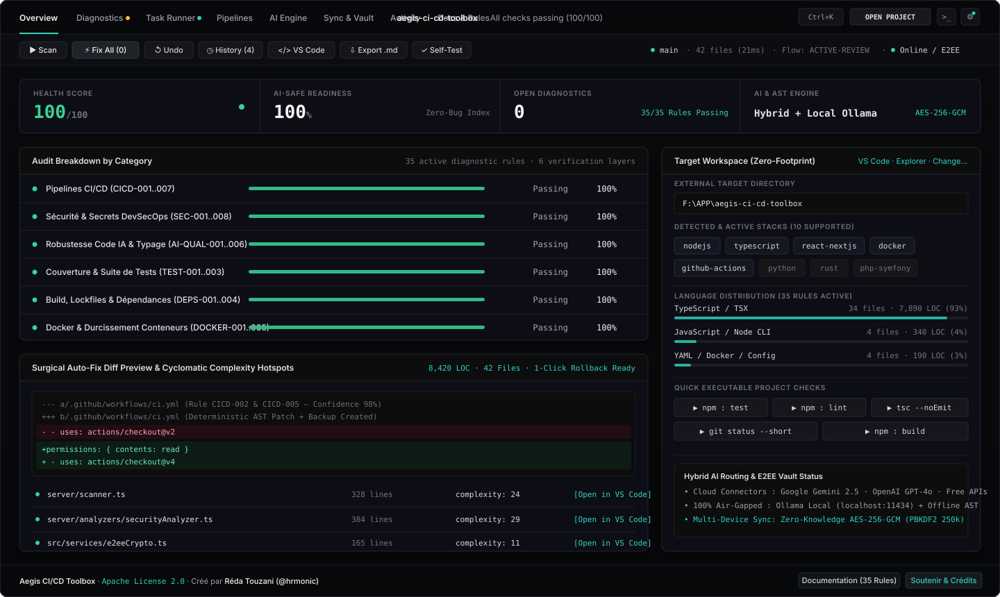
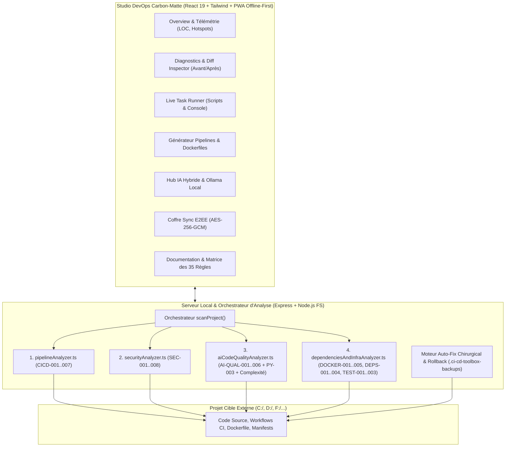

<div align="center">

# Aegis CI/CD Toolbox

### Studio DevOps & Moteur de Diagnostic / Auto-Correction CI/CD Multi-Stacks

[](./LICENSE)
[-18181b.svg)](https://github.com/hrmonic)
[](#matrice-complète-des-35-règles-de-diagnostic)
[](#stacks-supportées--détection-automatique)
[](#moteur-ia-hybride--mode-100-local-air-gapped)
[](#synchronisation-multi-appareils-chiffrée-de-bout-en-bout-e2ee)

<p align="center">
  <strong>Utilitaire de diagnostic CI/CD externe (« Zero-Footprint »), d'audit DevSecOps et d'auto-correction chirurgicale conçu pour garantir des applications robustes, maintenables et zéro-bug — y compris sur du code généré par IA.</strong>
</p>

---



</div>

---

## Sommaire

1. [Présentation & Philosophie « Zero-Footprint »](#1-présentation--philosophie-zero-footprint)
2. [Architecture Technique du Moteur](#2-architecture-technique-du-moteur)
3. [Matrice Complète des 35 Règles de Diagnostic](#3-matrice-complète-des-35-règles-de-diagnostic)
4. [Moteur d'Auto-Correction Chirurgicale & Rollback 1-Clic](#4-moteur-dauto-correction-chirurgicale--rollback-1-clic)
5. [Moteur IA Hybride & Mode 100% Local (Ollama Air-Gapped)](#5-moteur-ia-hybride--mode-100-local-ollama-air-gapped)
6. [Synchronisation Multi-Appareils Chiffrée de Bout en Bout (E2EE)](#6-synchronisation-multi-appareils-chiffrée-de-bout-en-bout-e2ee)
7. [Mode Hors-Ligne Complet (PWA) & Notifications Adaptatives](#7-mode-hors-ligne-complet-pwa--notifications-adaptatives)
8. [Installation, Démarrage Rapide & Référence CLI](#8-installation-démarrage-rapide--référence-cli)
9. [Crédits, Licence Apache 2.0 & Soutenir le Projet](#9-crédits-licence-apache-20--soutenir-le-projet)

---

## 1. Présentation & Philosophie « Zero-Footprint »

**Aegis CI/CD Toolbox** répond à une problématique centrale du développement moderne et du développement assisté par IA : détecter instantanément les failles de pipelines CI/CD, les fuites de secrets, les vulnérabilités d'injection, les anti-patterns laissés par les modèles de langage (blocs `catch {}` silencieux, contournements de typage `@ts-ignore` / `any`, arguments mutables par défaut en Python, fonctions non implémentées) et les corriger en un clic.

### Pourquoi l'architecture « Zero-Footprint » ?
Contrairement aux linters classiques qui imposent d'installer des dizaines de dépendances dans chaque dépôt cible :
- **Aegis CI/CD Toolbox vit en dehors de vos projets** : vous indiquez simplement le chemin de n'importe quel dossier local sur vos disques (`C:\`, `D:\`, `F:\`, etc.) via l'explorateur natif Windows ou le navigateur de disques intégré.
- **Aucune pollution du projet cible** : toutes les sauvegardes automatiques avant patch (`.bak`) et l'historique d'annulation (`history.json`) sont stockés de manière isolée dans `.ci-cd-toolbox-backups/<nom-du-projet>/`.
- **Intégration directe au workflow développeur** : ouverture directe d'un fichier à la ligne exacte du bug dans **VS Code** (`code -g fichier:ligne`), révélation dans l'**Explorateur Windows**, et **Console d'exécution en direct (Task Runner)** pour lancer les scripts `npm`, `pytest`, `cargo`, `go test` ou `git status` sans quitter l'interface.

---

## 2. Architecture Technique du Moteur



---

## 3. Matrice Complète des 35 Règles de Diagnostic

Le moteur exécute **35 règles de vérification statique et structurelle** réparties en **6 couches de contrôle** :

### Couche 1 — Pipelines CI/CD (`server/analyzers/pipelineAnalyzer.ts`)

| ID Règle | Sévérité | Stack | Description du Diagnostic | Auto-Correction (Patch) |
| :--- | :---: | :---: | :--- | :--- |
| **`CICD-001`** | `CRITICAL` | `github-actions` | Absence de workflow CI/CD dans `.github/workflows/` | Génère un workflow multi-stacks complet et durci |
| **`CICD-002`** | `HIGH` | `github-actions` | Permissions `GITHUB_TOKEN` non restreintes | Injecte `permissions: contents: read` en tête du fichier |
| **`CICD-003`** | `MEDIUM` | `github-actions` | Absence de `timeout-minutes` sur les jobs CI | Injecte `timeout-minutes: 15` après `runs-on` |
| **`CICD-004`** | `LOW` | `github-actions` | Absence de groupe `concurrency` (`cancel-in-progress`) | Injecte le bloc `concurrency` indexé sur `${{ github.ref }}` |
| **`CICD-005`** | `MEDIUM` | `github-actions` | Action GitHub obsolète (`@v1/@v2/@v3`) ou flottante (`@master/@latest`) | Met à niveau la référence de l'action vers `@v4` |
| **`CICD-006`** | `CRITICAL` | `github-actions` | Injection shell via `${{ github.event... }}` dans un bloc `run:` | Extrait l'expression vers une variable d'environnement `env:` |
| **`CICD-007`** | `MEDIUM` | `github-actions` | Utilisation de `npm install` au lieu de `npm ci` en pipeline CI | Remplace `npm install` par `npm ci` (lockfile strict) |

### Couche 2 — Sécurité DevSecOps & Secrets (`server/analyzers/securityAnalyzer.ts`)

| ID Règle | Sévérité | Stack | Description du Diagnostic | Auto-Correction (Patch) |
| :--- | :---: | :---: | :--- | :--- |
| **`SEC-001`** | `CRITICAL` | `multi-stack` | Fichier `.gitignore` absent à la racine du dépôt | Crée un `.gitignore` complet protégeant `.env*`, `dist/`, `node_modules/` |
| **`SEC-002`** | `CRITICAL` | `multi-stack` | Les fichiers `.env` ne sont pas exclus dans `.gitignore` | Ajoute `.env` et `.env.*` à la fin de `.gitignore` |
| **`SEC-003`** | `CRITICAL` | `multi-stack` | Clé secrète en dur (OpenAI, Gemini, GitHub PAT, AWS AKIA, Stripe Live, Slack, Clé PEM, URI DB) | Extrait le secret vers `process.env.SECRET_API_KEY` ou `os.environ.get()` |
| **`SEC-004`** | `CRITICAL` | `nodejs / python` | Exécution dynamique de code arbitraire via `eval()` | Remplace `eval()` par `JSON.parse()` ou `ast.literal_eval()` |
| **`SEC-005`** | `HIGH` | `react-nextjs` | Vecteur XSS DOM via `.innerHTML =` ou `dangerouslySetInnerHTML=` | Remplace `.innerHTML =` par `.textContent =` |
| **`SEC-006`** | `HIGH` | `python` | Exécution shell risquée via `subprocess(..., shell=True)` ou `os.system()` | Passe `shell=True` à `shell=False` |
| **`SEC-007`** | `CRITICAL` | `multi-stack` | Injection SQL par concaténation ou f-string dans `SELECT/INSERT/UPDATE/DELETE` | Convertit l'interpolation en paramètre préparé lié (`?`) |
| **`SEC-008`** | `HIGH` | `nodejs / python` | Vérification SSL/TLS désactivée (`verify=False` ou `NODE_TLS_REJECT_UNAUTHORIZED='0'`) | Rétablit la vérification stricte des certificats TLS |

### Couche 3 — Robustesse du Code IA & Télémétrie (`server/analyzers/aiCodeQualityAnalyzer.ts`)

| ID Règle | Sévérité | Stack | Description du Diagnostic | Auto-Correction (Patch) |
| :--- | :---: | :---: | :--- | :--- |
| **`AI-QUAL-001`** | `MEDIUM` | `typescript / js` | Bloc `catch {}` vide avalant les exceptions silencieusement | Injecte une journalisation explicite de l'erreur capturée |
| **`AI-QUAL-002`** | `LOW` | `typescript` | Contournement du typage (`: any`, `as any`, `@ts-ignore`, `@ts-nocheck`) | Remplace `: any` par `: unknown` et `@ts-ignore` par `@ts-expect-error` |
| **`AI-QUAL-003`** | `HIGH` | `multi-stack` | Fonction stub IA inachevée (`raise NotImplementedError` / `throw new Error("Not implemented")`) | Signale le bloc inachevé et génère un squelette de retour sûr |
| **`AI-QUAL-004`** | `HIGH` | `python` | Argument par défaut mutable en Python (`def fn(items=[]):` ou `data={}`) | Remplace la valeur par défaut mutable par `None` |
| **`AI-QUAL-005`** | `MEDIUM` | `multi-stack` | Point d'arrêt de débogage oublié (`debugger;`, `breakpoint()`, `pdb.set_trace()`, `var_dump()`) | Commente ou retire l'instruction de debug |
| **`AI-QUAL-006`** | `MEDIUM` | `rust` | Appel `.unwrap()` susceptible de paniquer en production Rust | Remplace `.unwrap()` par `.expect("Unexpected None/Err")` |
| **`PY-003`** | `MEDIUM` | `python` | Clause `except:` nue interceptant `SystemExit` et `KeyboardInterrupt` | Remplace `except:` par `except Exception as exc:` |

### Couche 4 — Conteneurs Docker & Infrastructure (`server/analyzers/dependenciesAndInfraAnalyzer.ts`)

| ID Règle | Sévérité | Stack | Description du Diagnostic | Auto-Correction (Patch) |
| :--- | :---: | :---: | :--- | :--- |
| **`DOCKER-001`** | `MEDIUM` | `docker` | Absence de `Dockerfile` multi-stage sécurisé | Génère un `Dockerfile` multi-stage avec utilisateur non-root et `HEALTHCHECK` |
| **`DOCKER-002`** | `HIGH` | `docker` | Conteneur exécuté en tant que `root` (absence de directive `USER`) | Ajoute `USER node` / `USER appuser` avant `CMD` |
| **`DOCKER-003`** | `MEDIUM` | `docker` | Image de base Docker utilisant le tag flottant `:latest` | Épingle le tag vers `:lts-alpine` |
| **`DOCKER-004`** | `LOW` | `docker` | Absence de sonde `HEALTHCHECK` dans le `Dockerfile` | Ajoute une directive `HEALTHCHECK` standard |
| **`DOCKER-005`** | `MEDIUM` | `docker` | Absence de fichier `.dockerignore` à côté du `Dockerfile` | Crée un `.dockerignore` excluant `node_modules`, `.git`, `.env*`, `dist` |

### Couches 5 & 6 — Build, Dépendances & Suite de Tests (`server/analyzers/dependenciesAndInfraAnalyzer.ts`)

| ID Règle | Sévérité | Stack | Description du Diagnostic | Auto-Correction (Patch) |
| :--- | :---: | :---: | :--- | :--- |
| **`DEPS-001`** | `LOW` | `nodejs` | Version du moteur Node.js (`engines.node`) non spécifiée dans `package.json` | Ajoute `"engines": { "node": ">=20.0.0" }` dans `package.json` |
| **`DEPS-002`** | `HIGH` | `nodejs` | Absence de fichier de verrouillage (`package-lock.json`, `pnpm-lock.yaml`, `yarn.lock`) | Recommande la génération via `npm install --package-lock-only` |
| **`DEPS-003`** | `HIGH` | `nodejs` | Dépendance NPM utilisant une version flottante `*` ou `latest` | Remplace `*` / `latest` par une plage sémantique `^1.0.0` |
| **`DEPS-004`** | `MEDIUM` | `typescript` | Mode `"strict": true` non activé dans `tsconfig.json` | Active `"strict": true` dans `compilerOptions` |
| **`PY-001`** | `MEDIUM` | `python` | Absence de `pyproject.toml` (configuration Ruff & Pytest) | Génère un fichier `pyproject.toml` préconfiguré |
| **`PY-002`** | `MEDIUM` | `python` | Paquets Python non épinglés dans `requirements.txt` | Verrouille les versions minimales compatibles (`>=1.0.0`) |
| **`PHP-001`** | `MEDIUM` | `php-symfony` | Absence de configuration d'analyse statique `phpstan.neon` | Génère `phpstan.neon` configuré au niveau 6 |
| **`TEST-001`** | `HIGH` | `nodejs` | Script `"test"` absent ou non configuré dans `package.json` | Configure `"test": "vitest run"` dans `package.json` |
| **`TEST-002`** | `HIGH` | `multi-stack` | Aucun fichier de test unitaire ou d'intégration détecté dans le projet | Génère une suite initiale Vitest (`tests/smoke.test.ts`) ou Pytest (`tests/test_smoke.py`) |
| **`TEST-003`** | `LOW` | `typescript` | Test automatisé désactivé (`.skip`, `xit`, `xdescribe`) | Retire `.skip` pour rétablir la couverture de non-régression |

---

## 4. Moteur d'Auto-Correction Chirurgicale & Rollback 1-Clic

Chaque diagnostic remonte une proposition `AutoFixProposal` évaluée selon un indice de confiance (`0-100%`) :
- **Prévisualisation Diff Unifiée** : l'onglet **Diagnostics** affiche côte à côte le fragment de code avant et après modification avant toute écriture disque.
- **Préservation de l'indentation** : le moteur `applyAutoFixOnDisk` remplace les lignes cibles en conservant l'indentation exacte du fichier source et valide la syntaxe JSON lors des patchs `package.json`.
- **Historique & Rollback Hors-Projet** : chaque fichier modifié ou créé est enregistré dans `.ci-cd-toolbox-backups/<slug>/`. Le bouton **Undo / History** restaure l'état exact d'origine en un clic.

---

## 5. Moteur IA Hybride & Mode 100% Local (Ollama Air-Gapped)

Dans l'onglet **AI Engine**, vous choisissez librement votre stratégie d'analyse contextuelle :
1. **Google Gemini** (`gemini-2.5-flash`, `gemini-2.5-pro`)
2. **OpenAI** (`gpt-4o`, `gpt-4o-mini`)
3. **APIs Gratuites** (OpenRouter Free Tier `deepseek-r1:free`, `llama-3.3-70b:free`, Groq)
4. **Ollama 100% Local (`http://localhost:11434`)** : détection automatique des modèles installés sur votre machine (`qwen2.5-coder`, `deepseek-coder`, `llama3.2`, etc.).
5. **Mode Air-Gapped Strict** : une option coupe tout appel réseau externe et garantit qu'aucun fragment de code ne quitte votre poste.

---

## 6. Synchronisation Multi-Appareils Chiffrée de Bout en Bout (E2EE)

Le module **Sync & Vault** (`src/services/e2eeCrypto.ts`) implémente un chiffrement **Zero-Knowledge** natif via l'API Web Crypto standard :
- **Dérivation de clé** : `PBKDF2-SHA256` avec **250 000 itérations** et sel aléatoire de 128 bits.
- **Chiffrement authentifié** : `AES-256-GCM` avec vecteur d'initialisation (IV) de 96 bits généré aléatoirement à chaque synchronisation.
- **Vérification d'intégrité** : empreinte `SHA-256` du payload vérifiée après déchiffrement.

---

## 7. Mode Hors-Ligne Complet (PWA) & Notifications Adaptatives

- **Mode Offline-First** : grâce au Service Worker (`public/sw.js`) et au cache persistant (`src/services/offlineStore.ts`), l'interface reste 100% opérationnelle hors connexion avec file d'attente de synchronisation différée.
- **Notifications Adaptatives au Flux Cognitif** (`src/services/adaptiveNotify.ts`) : calcule en temps réel votre cadence d'actions par minute (`RPM`). En phase de concentration intense (**Deep Focus**), les alertes non critiques sont automatiquement mises en sourdine dans un digest différé pour ne jamais interrompre votre travail.

---

## 8. Installation, Démarrage Rapide & Référence CLI

### Prérequis
- **Node.js** `>= 20.0.0`

### 1. Cloner et installer
```bash
git clone https://github.com/hrmonic/aegis-ci-cd-toolbox.git
cd aegis-ci-cd-toolbox
npm install
```

### 2. Lancer le Studio DevOps (Interface Web + Serveur Local)
```bash
npm run dev
```
Ouvrez ensuite **`http://localhost:5173`** dans votre navigateur. Cliquez sur **`OPEN PROJECT`** en haut à droite pour sélectionner n'importe quel dossier de projet sur vos disques.

### 3. Utiliser la CLI en ligne de commande ou dans un pipeline CI/CD

| Commande | Description |
| :--- | :--- |
| `npm run scan` | Analyse le répertoire courant et affiche le rapport complet dans le terminal |
| `npm run scan -- "C:/chemin/vers/projet"` | Analyse n'importe quel projet externe sans s'y installer |
| `npm run scan -- "C:/chemin/vers/projet" --strict` | Retourne un code de sortie `1` si des problèmes critiques sont détectés (idéal en CI) |
| `node bin/ci-cd-toolbox.js fix "C:/chemin/vers/projet"` | Applique automatiquement tous les correctifs déterministes haute confiance (`>= 90%`) |
| `node bin/ci-cd-toolbox.js init "C:/chemin/vers/projet"` | Génère et injecte un workflow GitHub Actions et un Dockerfile durci dans le projet cible |
| `npm run pack:toolbox` | Compile et génère une archive portable `.tgz` installable hors-ligne |
| `npm test` | Exécute la suite de tests unitaires et d'intégration Vitest |

---

## 9. Crédits, Licence Apache 2.0 & Soutenir le Projet

<table width="100%">
  <tr>
    <td width="72%" valign="top">
      <h3>Créateur & Architecte</h3>
      <p>
        Conçu et développé par <strong>Réda Touzani</strong> (<a href="https://github.com/hrmonic"><strong>@hrmonic</strong></a>).
      </p>
      <h3>Licence Open Source</h3>
      <p>
        Ce projet est distribué sous licence <strong><a href="./LICENSE">Apache License 2.0</a></strong> (<code>Copyright © 2026 Réda Touzani</code>). Vous êtes libre d'utiliser, modifier et distribuer ce logiciel à des fins personnelles ou commerciales dans le respect des termes de la licence Apache 2.0.
      </p>
      <h3>Soutenir le Projet</h3>
      <p>
        Si <strong>Aegis CI/CD Toolbox</strong> vous fait gagner du temps et sécurise vos déploiements, vous pouvez soutenir son développement open-source en scannant le QR code ci-contre.
      </p>
    </td>
    <td width="28%" align="center" valign="middle">
      
      <br />
      <sub><strong>Scanner pour soutenir le projet</strong></sub>
    </td>
  </tr>
</table>
